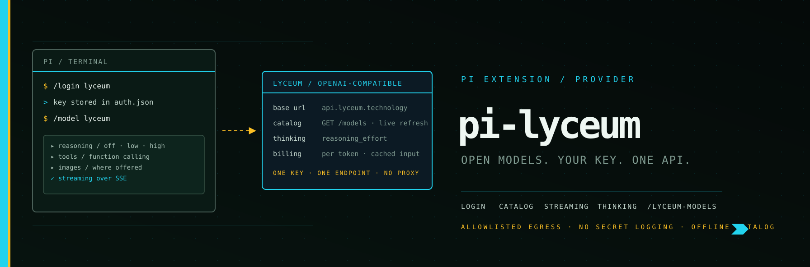

<p align="center">
  
</p>

# pi-lyceum

> Lyceum provider for [pi](https://pi.dev) — run Lyceum's open models from pi
> through its OpenAI-compatible API, with **your own** Lyceum API key.

```bash
pi install npm:@pixu1980/pi-lyceum
```

## What it does

Lyceum serves 17 open models behind one OpenAI-compatible endpoint. This
extension registers a `lyceum` provider in pi, so those models show up in
`/model` with their real context windows and prices, and every chat turn goes
through pi's own `openai-completions` implementation: streaming SSE, tool
calling, image input where the model accepts it, usage accounting and
cancellation are the host's, not a reimplementation.

- **`lyceum` provider** — the bundled Lyceum chat catalog, priced per million
  tokens, visible in `/model` after `/login lyceum`.
- **`/login lyceum`** — paste your Lyceum API key once; pi stores it in
  `~/.pi/agent/auth.json` (mode 0600). There is no environment-variable
  fallback: the stored key is the only source.
- **Live catalog overlay** — pi's model refresh calls `GET /models`; ids the
  bundle knows keep their metadata, ids it does not know are added with
  conservative defaults (see [Catalog freshness](#catalog-freshness)).
- **`/lyceum-models`** — refresh the live catalog and re-register the provider
  without restarting pi.
- **Thinking levels** — pi's `off … max` levels map onto Lyceum's
  `reasoning_effort` enum (`none`, `low`, `medium`, `high`), and `off` is sent
  explicitly, because reasoning is on by default on the models that support it.

## Install

```bash
pi install npm:@pixu1980/pi-lyceum
```

Then, inside pi:

```
/login lyceum          # paste your Lyceum API key (lk_…)
/model                 # pick a Lyceum model
```

Generate the key in the Lyceum dashboard at
<https://dashboard.lyceum.technology/api-keys>.

## Commands

| Command | What it does |
| --- | --- |
| `/lyceum-models` | Refresh the live model catalog from `GET /models` and re-register the provider |

## Models

The bundled snapshot, read from <https://lyceum.technology/models.md> on
2026-11-27. Prices are USD per million tokens; the cached-input column is what
a prompt-cache hit costs.

| Model | ID | Context | Input | Cached input | Output | Reasoning |
| --- | --- | --- | --- | --- | --- | --- |
| DeepSeek V4.1 Flash | `deepseek/deepseek-v4.1-flash` | 1M | $0.33 | $0.033 | $1.30 | yes |
| GLM-5.3 | `z-ai/glm-5.3` | 1M | $1.40 | $0.26 | $4.40 | yes |
| Kimi K3.1 Pro | `moonshotai/kimi-k3.1-pro` | 1M | $2.00 | $0.20 | $10.00 | yes |
| GLM-5.3 Flash | `z-ai/glm-5.3-flash` | 1M | $0.20 | $0.05 | $0.50 | yes |
| Kimi K2.7 Code | `moonshotai/kimi-k2.7-code` | 256K | $1.25 | $0.31 | $4.50 | yes |
| Qwen3.8 2.4T A95B | `qwen/qwen3.8-2.4t-a95b` | 256K | $2.50 | $0.63 | $6.00 | yes |
| MiniMax M3.1 Flash | `minimax/minimax-m3.1-flash` | 1M | $0.30 | $0.075 | $1.20 | yes |
| Qwen3.8 27B | `qwen/qwen3.8-27b` | 256K | $0.40 | $0.10 | $2.40 | yes |
| Lyceum Router | `lyceum/router` | 1M | $0.30 | $0.075 | $1.20 | yes |
| Lyceum Simple | `lyceum/simple` | 256K | $0.40 | $0.10 | $2.40 | yes |
| Lyceum Complex | `lyceum/complex` | 1M | $0.30 | $0.075 | $1.20 | yes |
| Lyceum Reasoning | `lyceum/reasoning` | 1M | $1.40 | $0.26 | $4.40 | yes |
| DeepSeek V4 Flash | `deepseek/deepseek-v4-flash-0731` | 1M | $0.25 | $0.06 | $0.30 | yes |
| Qwen3.8 27B Instant | `qwen/qwen3.8-27b-instant` | 256K | $0.40 | $0.10 | $2.40 | no |
| GLM-5.3 Flash Instant | `z-ai/glm-5.3-flash-instant` | 1M | $0.20 | $0.05 | $0.50 | no |
| GLM-5.3 Instant | `z-ai/glm-5.3-instant` | 1M | $1.40 | $0.26 | $4.40 | no |

The embedding model (`qwen/qwen3-embedding-8b`) is deliberately absent: it is
reachable through `POST /embeddings` only, and listing it as a chat model would
produce a `400` in the picker.

Lyceum's documented per-request output ceiling is 131,072 tokens, so no model
asks for more.

## Thinking levels

Lyceum accepts `reasoning_effort` with `none`, `low`, `medium`, `high`, and
`none` disables thinking on the models that support switching it off.

| pi level | Sent as |
| --- | --- |
| `off` | `reasoning_effort: "none"` |
| `minimal`, `low` | `"low"` |
| `medium` | `"medium"` |
| `high`, `xhigh`, `max` | `"high"` |

`off` is mapped explicitly because reasoning is on by default: omitting the
field would leave thinking enabled instead of turning it off. Models marked
"no" in the table above are the `-instant` variants and are registered without a
thinking map, so pi never sends a reasoning field for them.

## Catalog freshness

The bundled catalog is a snapshot, so pi works offline and before the first
refresh. At startup pi calls `GET /openai/v1/models` through the provider's
`fetchModels`, and `/lyceum-models` does the same on demand:

- an id the bundle knows is registered with the **live id and the bundled
  metadata** (context window, price, modalities, reasoning);
- an id the bundle does not know is registered with conservative defaults:
  131,072 context, 16,384 output, text-only, zero cost, no reasoning. The price
  shown for such a model is a placeholder, not a claim;
- ids that cannot answer a chat completion (anything with `embedding` in the
  name) are dropped;
- a **discovery failure never empties the picker**: the bundled catalog stays,
  and `/lyceum-models` reports the error when you ask for a refresh.

Because a live refresh can only overlay the bundled baseline, a model Lyceum
retires stays selectable until the next release of this package; selecting it
answers `404 model not found`. The bundled snapshot is updated when the catalog
changes.

## Configuration

There are no environment variables. The API key comes from `/login lyceum` and
lives in pi's own credential store; this package reads it for `/lyceum-models`
and never writes, caches or prints it.

## Egress

| Request | When | Sent |
| --- | --- | --- |
| `GET https://api.lyceum.technology/openai/v1/models` | pi's model refresh, `/lyceum-models` | the bearer key |
| `POST https://api.lyceum.technology/openai/v1/chat/completions` | every chat turn, issued by pi | the bearer key, your prompt and the tool definitions |

Nothing else is contacted. The extension makes no other request of its own, and
the discovery call refuses redirects, checks the final URL against the
`api.lyceum.technology` allowlist, caps the response body at 1 MiB and times out
after 10 seconds. A source-level test fails if a second host, a `fetch` outside
the discovery module, a process spawn or a filesystem write is added.

See [DISCLOSURE](./DISCLOSURE) for the field-by-field statement and
[SECURITY.md](../../SECURITY.md) for the repository's trust boundary.

## Requirements

Node 22.19.0 or newer, which is what pi itself requires. The host supplies
`@earendil-works/pi-ai` and `@earendil-works/pi-coding-agent`, declared here as
peers and never bundled.

## License

`MIT`
