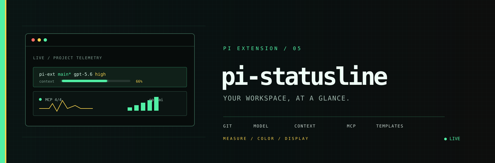

<p align="center">
  
</p>

# pi-statusline

> Statusline extension for [pi](https://pi.dev) - replicates `/statusline` from Claude Code with customizable templates, git status, model info, and context usage with gradient colors.

## Install

```bash
pi install npm:@pixu1980/pi-statusline
```

## Features

A dual-line status display for `pi-coding-agent`:

- **Session name on the editor border:** the current session name (set with `/name`, the session picker, or an auto-naming extension) is mirrored on the right edge of the border above the prompt, opposite the reasoning spinner. It is painted with the editor's border colour, the same one pi uses for the reasoning spinner and for the border dashes, so it follows the thinking level and the bash-mode border. It stays out of the way when the session has no name, and a name that does not fit is truncated with `…`.
- **Line 1 (widget, below editor):** project name, git branch/status, model info, thinking level, and context usage with a gradient color scale.
- **Line 2 (footer, replaces native):** MCP server status on the left, provider/model info on the right.
- **Responsive auto format (default):** the widget re-measures the available width on every render and picks the most verbose layout that fits, degrading through four levels while preserving colors:
  - full: `Project: ~/…/my-app › Branch: main › Model: DeepSeek V4 Flash Effort: High › Context: 0/1.0M (0%)`
  - verbose: `P: ~/…/my-app › B: main › M: DeepSeek V4 Flash E: High › C: 0/1.0M (0%)`
  - compact: `P: my-app › B: main › M: DeepSeek V4 Flash - High › C: 0/1.0M`
  - minimal: `my-app | main | DeepSeek V4 Flash - High | 0/1.0M`

  The context separator (`/` between used and total) keeps the percentage gradient color at every level, even when the `(pct)` suffix is dropped.

  Switch the `Format` setting to `preset-full` / `preset-compact` / `preset-minimal` for a fixed layout, or `custom` for your own template.

## Commands

| Command | Description |
| --- | --- |
| `/statusline` | Print the current statusline in the output |
| `/statusline settings` | Open the interactive settings panel |
| `/statusline template` | Set a custom template string |
| `/statusline reload` | Reload settings from disk |

## Customization

Templates support placeholders for project, git branch, git status (ahead/behind/modified/untracked), model name, provider, thinking level, context usage, and MCP server counts. See the settings panel (`/statusline settings`) for the full list and live preview.

The session name label installs a custom editor component (a `CustomEditor` subclass that decorates only the top border). If another extension also calls `setEditorComponent`, only one editor can be active: the last one installed wins.

## License

MIT
